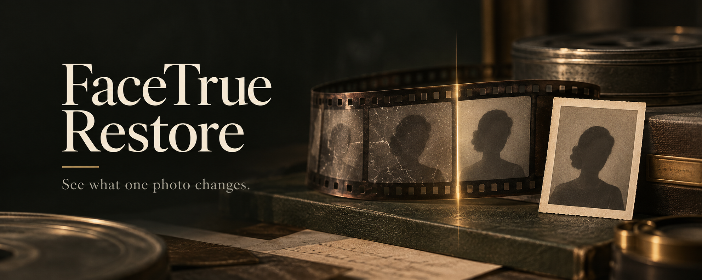
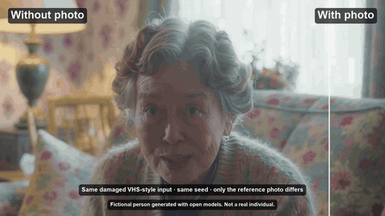
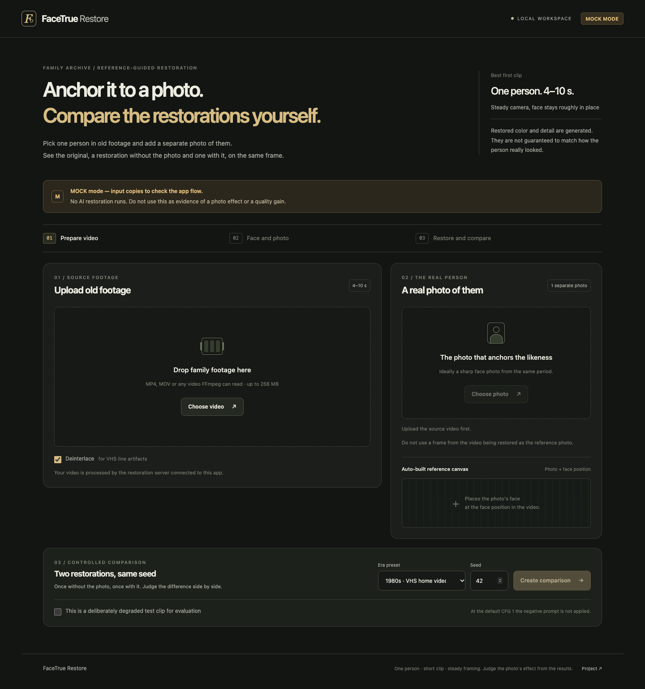

# FaceTrue Restore



*Conceptual brand artwork generated for this project.*

**See what one photo changes.**

FaceTrue Restore is a local, open-weights video restoration prototype. Add a short clip and a separate photo of the person, then compare the original with two restorations: one made without the photo and one guided by it.

[See the comparison](#see-it-in-action) · [Quick start](#quick-start) · [GPU setup](#run-with-a-gpu) · [Pilot results](#pilot-results-small-test) · [Documentation](#documentation)

> **Prototype status:** The app and comparison workflow work in mock mode without a GPU. Real restoration requires the separately configured ComfyUI backend. Generated faces, colors, and details are not guaranteed to match the original.

## See it in action

<p align="center">
  
  <br>
  <sub>A fictional person generated with open models. The input and seed are the same; only the reference photo differs.</sub>
</p>

This is one comparison from deliberately degraded synthetic footage. It illustrates what the photo changed in this run, not a guarantee of recovery or identity fidelity.

## From footage to comparison

1. **Prepare a clip.** Upload a 4-10 second video with one person and a steady camera. The app can deinterlace the video and normalizes it to a consistent frame rate and canvas.
2. **Add the reference.** Select the person's face in the first frame, upload a separate photo, and inspect the proposed crop and reference canvas.
3. **Restore and compare.** Run both versions with the same input and per-window seeds. Play the original and both outputs together, then download a labeled comparison or moving wipe with the run manifest. Exports retain the source audio when present.

The photo is placed at the selected face location on a gray canvas and supplied as a guide to LTX-2.5 Restore. For longer clips, the app uses 97-frame windows with 17-frame overlaps. Each restoration carries its own prior restored frames; output frames are checked and aligned for comparison.

## The workspace

<p align="center">
  
  <br>
  <sub>The actual local app before media is added, in mock mode. Mock outputs are labeled input copies, not AI restorations.</sub>
</p>

## Choose a mode

| | Mock mode | ComfyUI mode |
|---|---|---|
| Use it to | Try the interface, selection, exports, and downloads | Run the LTX restoration workflow |
| Requirements | Python and FFmpeg; no GPU or model weights | The app plus a reachable ComfyUI server, LTX nodes, model weights, and a suitable NVIDIA GPU |
| Result | Labeled input copies | Separate no-photo and photo-guided restorations |

A GPU run was recorded on one RTX 5090 with ComfyUI `--lowvram`; other setups have not been established to fit. See [performance and limits](#performance-and-limits) and run the [GPU preflight](docs/GPU_PREFLIGHT.md) on your own hardware.

## Quick start

These instructions start the app on a Mac in mock mode. You need Git, Python 3.11 or newer (or `uv`), and FFmpeg with `ffprobe`. On macOS, FFmpeg can be installed with `brew install ffmpeg`.

```bash
git clone https://github.com/junjunjunbong/facetrue-restore.git
cd facetrue-restore
bash scripts/setup.sh
cp -n .env.example .env
FACETRUE_MODE=mock bash scripts/run.sh
```

Open [http://127.0.0.1:8000](http://127.0.0.1:8000). A private checkout requires a GitHub account with access. The setup script creates `.venv` and installs the locked app dependencies.

1. Upload an MP4, MOV, AVI, MKV, M4V, or WebM clip. The default upload limit is 256 MB.
2. Click the person's face in the first frame and adjust the selection.
3. Add a separate photo, choose the right face if needed, and inspect the crop and reference canvas.
4. Choose a preset and seed, then create the comparison. Mark deliberately degraded evaluation material as a synthetic test clip.
5. Review the synchronized views and download the comparison and execution manifest.

Automatic detection may fail on old footage. The app identifies a center-crop fallback, and a photo with multiple detected faces requires an explicit selection. For a read-only check of the mock setup:

```bash
FACETRUE_MODE=mock .venv/bin/python scripts/doctor.py
```

## Run with a GPU

The tested arrangement runs the browser UI, FastAPI, and a local proxy on a Mac, with ComfyUI on a separate GPU PC. Requests follow:

```text
Browser → FaceTrue / FastAPI → comfy-sdk → local proxy → ComfyUI + LTX on the GPU PC
```

1. Set up ComfyUI, the LTX custom nodes, and four model files using the [GPU setup and model guide](docs/MODELS.md). Model access terms may require your own acceptance on Hugging Face.
2. Start ComfyUI on the GPU PC and install the optional client dependencies on the Mac:

   ```bash
   bash scripts/setup.sh --comfy
   ```

3. Configure `.env`. Replace `192.0.2.10` with the trusted GPU PC's reachable LAN or VPN address:

   ```dotenv
   FACETRUE_MODE=comfy
   COMFYUI_URL=http://192.0.2.10:8188
   COMFY_PROXY_URL=http://127.0.0.1:8189
   ```

4. Start the proxy and app in separate terminals:

   ```bash
   bash scripts/run_proxy.sh
   ```

   ```bash
   bash scripts/run.sh
   ```

5. Check connectivity and model discovery, then run the [GPU preflight](docs/GPU_PREFLIGHT.md):

   ```bash
   .venv/bin/python scripts/doctor.py --require-gpu
   ```

The diagnostic does not run inference or establish restoration quality. In a two-machine setup, `COMFYUI_URL=http://127.0.0.1:8188` points back to the Mac, not the GPU PC. The proxy remains on the Mac's loopback interface.

The default graph uses the INT8 ConvRot LTX-2.5 distilled transformer, INT8 ConvRot Gemma 4 text encoder, Conv video VAE, and Restore IC-LoRA. It runs 8 distilled steps, CFG 1, and 960×544 spatial tiles. The default output canvas is **1280×736** at 24 fps; aspect ratio is preserved with padding. Keep `FACETRUE_STEPS=8`: other step counts are rejected. At CFG 1, negative conditioning from the period presets is skipped. See [workflow provenance](workflows/PROVENANCE.md) for the graph and adaptations.

### Command-line comparison

`--bbox` uses `x,y,width,height` in normalized output pixels. Optional `--photo-bbox` uses pixels in the EXIF-oriented reference photo. Replace the example coordinates with your selection.

```bash
.venv/bin/python scripts/restore.py data/source.mp4 \
  --photo data/separate-photo.jpg \
  --bbox 500,150,220,260 \
  --output data/runs/example-001 \
  --seed 42 --preset vhs_1980s --deinterlace
```

Use a new empty output directory. Add `--synthetic` for a deliberately degraded test clip. Mock outputs are identified as input copies.

## Pilot results (small test)

A controlled pilot compared no photo, the correct person's separate photo, and another person's photo on three public-domain clips. The clips were deliberately given **strong synthetic damage**, and each result was scored against the clean video using SFace cosine similarity. The table reports the mean across the three clips; 13 frames per clip were sampled, with full common detection coverage.

| Render seed | Without photo | Correct photo | Other person's photo | Correct − without |
|---|---:|---:|---:|---:|
| 42 | 0.717 | 0.809 | 0.711 | +0.092 |
| 7 | 0.724 | 0.788 | 0.703 | +0.064 |

<details>
<summary>Per-clip results for seed 42</summary>

| Clip | Damaged input | No photo | Correct photo | Other photo | Correct − no photo | Correct − other |
|---|---:|---:|---:|---:|---:|---:|
| Obama | 0.680 | 0.728 | 0.861 | 0.694 | +0.133 | +0.167 |
| Biden | 0.692 | 0.652 | 0.762 | 0.654 | +0.111 | +0.108 |
| Michelle Obama | 0.608 | 0.773 | 0.804 | 0.783 | +0.031 | +0.020 |

Each result is a mean over 13 sampled frames of a 97-frame clip. The correct-photo condition scored higher than no-photo on 13/13, 13/13, and 12/13 frames respectively.
</details>

The correct-photo condition scored higher on these heavily degraded clips, but results varied by person and seed. With the repository's milder degradation, the effect was small and mixed. A similarity score is a diagnostic, not proof of recovered identity or historically accurate detail; the background, colors, and expression can change too. Three clips are a pilot, and adjacent frames are not independent examples.

The [technical report](docs/TECHNICAL_REPORT.md) contains both seeds, per-clip results, mild-damage results, side effects, and negative experiments. The strong-damage runs used a local wrapper around the evaluation script; that wrapper and the raw video-containing records are gitignored, so a repository checkout alone does not reproduce the main table. The [demo source list](docs/DEMO.md#benchmark-sources-not-shown-in-the-demo) records the clips and portraits.

To run a new controlled evaluation with the repository's default degradation, follow the [evaluation guide](docs/EVALUATION.md). It defines the input manifest, controls, coverage rules, and interpretation. Evaluation requires the real backend and refuses mock output.

## Performance and limits

On the recorded RTX 5090 setup, with 8 steps and a 1280×736 canvas:

- **10-second comparison:** a 240-frame job with three windows per arm, plus comparison export, took 482.4 seconds end to end.
- **GPU memory:** the sampled whole-device peak across the pilot runs was 31,927-32,087 MiB. This is not the model's exact allocation. GPU-PC system RAM and separate loading, sampling, and decoding times were not measured.
- **Scope:** one person, 4-10 seconds in the UI, and a face that stays roughly in place. Face tracking, relocation of the reference between windows, multiple-person restoration, and clips longer than ten seconds are not implemented.
- **Review required:** the model may alter identity, expression, age, background, or color. Window joins can flicker, so inspect them in the output.

These numbers describe one setup and selected inputs, not a performance guarantee. See the full [preflight record](docs/GPU_PREFLIGHT.md) and [technical report](docs/TECHNICAL_REPORT.md).

## Data and privacy

The app stores uploaded files, jobs, and outputs under `FACETRUE_DATA_DIR`, which defaults to `data/`. Remove local job data when it is no longer needed. In ComfyUI mode, video chunks and guide images are sent to the configured ComfyUI server, which may retain its own copies. Use a server you trust and manage its files separately.

The app is designed for a trusted local setup and does not provide multi-user authentication. Mock mode uses no GPU or external service. The gitignore excludes `data/`, `.env`, model weights, and common media formats; no private family media is included in the repository.

## Models and licenses

| Component | Role | Published terms / status |
|---|---|---|
| LTX-2.5 22B distilled | Core video model | LTX-2.x Community License |
| LTX-2.5 Restore IC-LoRA | Restoration adapter | LTX-2.x Community License |
| LTX-2.5 Conv video VAE | Video encode/decode | LTX-2.x distribution terms |
| Gemma 4 12B text encoder with LTX projections, Comfy INT8 (`Lightricks/LTX-2.5`, `text_encoders/gemma4-12b-with-proj-ltx-2.5-comfy-int8-convrot.safetensors`) | Local text conditioning | Distributed by Lightricks under the [LTX-2.x Community License](https://github.com/Lightricks/LTX-2/blob/main/LICENSE-2_x) ([model card](https://huggingface.co/Lightricks/LTX-2.5)); the Google Gemma 4 12B base model is [Apache-2.0](https://ai.google.dev/gemma/docs/gemma_4_license) ([model card](https://huggingface.co/google/gemma-4-12B-it)) |
| OpenCV Haar cascade | UI face proposals | Intel Open Source Computer Vision Library license in the classifier file |
| YuNet + SFace, optional | Evaluation detection and embeddings | YuNet MIT; SFace officially distributed Apache-2.0, exact training-data provenance **unverified** |

The INT8 Gemma 4 text encoder used here is Lightricks' customized package with LTX projections, so we treat it as governed by the LTX-2.x Community License rather than relabeling it Apache-2.0; Google's original Gemma 4 weights are Apache-2.0. Weights are downloaded locally from Hugging Face after a click-through access form; no hosted API is used.

Exact filenames, destinations and inspected license sources are in [docs/MODELS.md](docs/MODELS.md). Model access terms may require the user's own acceptance on Hugging Face. This app does not accept those terms automatically or include model weights.

App-owned code is [MIT](LICENSE). The adapted Lightricks workflow retains [its upstream license and notices](workflows/LICENSE.upstream.txt); MIT does not relicense upstream material or weights.

## Development

```bash
.venv/bin/python -m pytest -q
.venv/bin/ruff check app tests scripts
```

Tests cover configuration, workflow construction, crop geometry, chunk accounting, FFmpeg processing, exports, mock jobs, and evaluation safeguards. They do not establish LTX quality or GPU compatibility. For an optional browser smoke test and its prerequisites, see the [development-Mac validation record](docs/VALIDATION.md).

## Documentation

| Guide | What's inside |
|---|---|
| [Model and GPU setup](docs/MODELS.md) | ComfyUI installation, model files, configuration, and third-party terms |
| [GPU preflight](docs/GPU_PREFLIGHT.md) | Hardware checks and recorded timing and memory observations |
| [Evaluation guide](docs/EVALUATION.md) | Three-arm experiment, coverage, and interpretation |
| [Technical report](docs/TECHNICAL_REPORT.md) | Pilot results, runtime, ablations, limitations, and sources |
| [Demo plan](docs/DEMO.md) | Demo script, claims, and source licenses |
| [Brand assets](docs/BRAND_ASSETS.md) | README visual provenance and cover prompt |
| [Research notes](docs/RESEARCH_NOTES.md) · [Improvement plan](docs/IMPROVEMENT_PLAN.md) | Research context and follow-up ideas |
| [Development plan](docs/PLAN.md) · [Sample provenance](samples/README.md) | Project scope, original gate, and media sourcing |
| [Workflow provenance](workflows/PROVENANCE.md) · [Validation snapshot](docs/VALIDATION.md) | Graph adaptations and earlier CPU/mock checks |

## Challenge submission

Built for the [Comfy Open Source Higgsfield challenge](https://comfy.org/open-source-higgsfield/), targeting Open Weights Only and the LTX VFX bonus. The app workflow uses local models and excludes partner/API generation nodes. The [official page](https://comfy.org/open-source-higgsfield/) lists October 30, 2026 at 09:00 PT as the deadline, which is **October 31 at 01:00 KST**. The project target is **October 30 at 22:00 KST**. The owner will handle repository visibility and the actual submission. Submission materials include the app/source license and installation guide, a demo under two minutes, a model list, and a `#OpenSourceHiggsfield` post; the [demo plan](docs/DEMO.md) records the draft and remaining steps.
