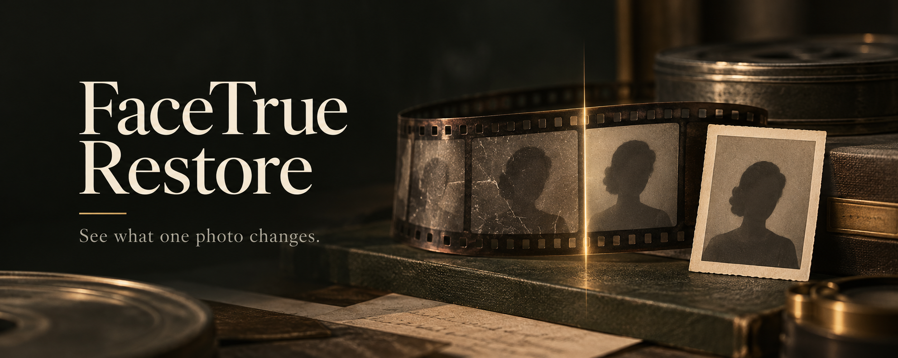
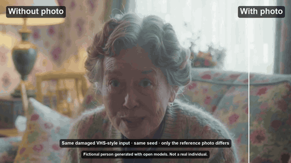
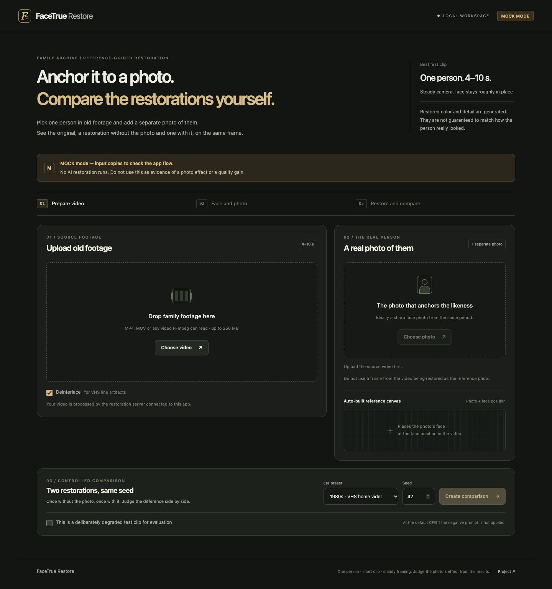
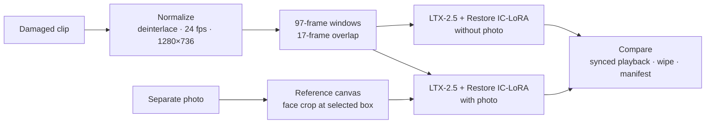
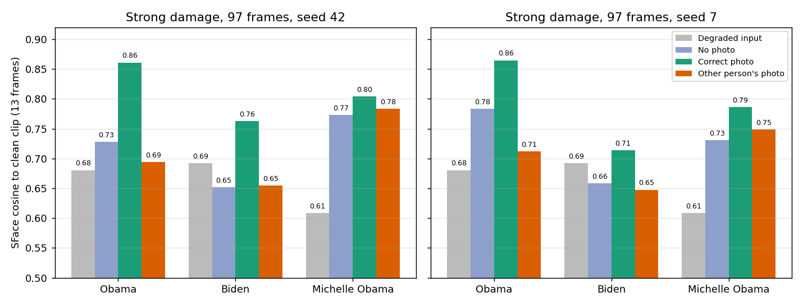

<div align="center">



<h3>Reference-guided video restoration with open weights.</h3>

<p>One damaged clip, one separate photo, two restorations, compared frame by frame.</p>

[](LICENSE)
[](pyproject.toml)
[](https://github.com/Comfy-Org/ComfyUI)
[](https://huggingface.co/Lightricks/LTX-2.5-22b-IC-LoRA-Restore)
[](#-models)
[](docs/TECHNICAL_REPORT.md)

[**Demo**](#-demo) · [**Quick Start**](#-quick-start) · [**GPU Inference**](#-gpu-inference) · [**Results**](#-results) · [**Models**](#-models) · [**Docs**](#-documentation)

</div>

---

**FaceTrue Restore** restores a short, damaged video of one person, using a separate photo of that person as a guide. It renders the clip twice: once without the photo and once guided by it. Both runs use the same input and the same seeds, so the only difference is the photo, and you can see exactly what it changed.

Everything runs locally on open weights: [LTX-2.5](https://huggingface.co/Lightricks/LTX-2.5) with the [Restore IC-LoRA](https://huggingface.co/Lightricks/LTX-2.5-22b-IC-LoRA-Restore), served through [ComfyUI](https://github.com/Comfy-Org/ComfyUI). There is no hosted API and no partner node.

> [!NOTE]
> FaceTrue Restore is a research prototype. Generated faces, colors, and details can differ from the real person and the original footage, so treat every output as an interpretation, not a recovery. The full interface also runs in **mock mode** on any machine, with no GPU required.

## 📰 News

- **2026-10-30** · 📄 Released the [technical report](docs/TECHNICAL_REPORT.md): results on two seeds, a mild-damage study, runtime, and five rounds of ablations (about 40 configurations).
- **2026-10-30** · 🏆 Submitted to the [Comfy Open Source Higgsfield challenge](https://comfy.org/open-source-higgsfield/) (Open Weights Only track, LTX VFX bonus).
- **2026-10-29** · 🔥 First end-to-end GPU runs on an RTX 5090. On strongly degraded clips, the correct photo raised mean SFace similarity to the clean video from **0.717 to 0.809** (seed 42).

## ✨ Highlights

- **One photo makes a measurable difference.** A separate portrait is placed at the face's position on a neutral canvas and passed to LTX-2.5 Restore as an IC-LoRA guide.
- **Controlled by construction.** Both versions share the input bytes, prompt, steps, and per-window seeds. Only the reference photo differs.
- **Long clips without lost frames.** 97-frame windows overlap by 17 frames. Each version carries its own restored history, and the output frame count is checked against the input.
- **Built for review.** Synchronized three-way playback, side-by-side and moving-wipe exports, the original audio, and a run manifest for every job.
- **Ready for old footage.** Optional deinterlacing, frame-rate and canvas normalization, and period presets (`neutral`, `vhs_1980s`, `film_1940s`).
- **Local and open.** Open weights only, with no partner or API nodes. Your footage stays on hardware you control.

## 🎬 Demo

<p align="center">
  
</p>
<p align="center">
  <sub>Moving wipe between the two versions: <b>without photo</b> on the left, <b>with photo</b> on the right. The input and seed are identical.<br>The person is fictional and was generated with open models. The damage is synthetic.</sub>
</p>

This is one run on deliberately degraded footage. It shows what the photo changed in that run. It does not guarantee recovery or identity fidelity.

<details>
<summary><b>The workspace</b></summary>
<br>
<p align="center">
  
  <br>
  <sub>The local app before media is added, running in mock mode. Mock outputs are labeled copies of the input, not AI restorations.</sub>
</p>
</details>

## 🔍 How It Works



1. **Prepare the clip.** Upload a 4–10 second video with one person and a steady camera. The app can deinterlace it, and it normalizes the frame rate and canvas.
2. **Add the reference.** Click the person's face in the first frame, upload a separate photo, and confirm the crop. The crop is pasted onto an output-sized gray canvas at the selected box and fed to the model through `LTXAddVideoICLoRAGuide`.
3. **Restore both versions.** The graph runs 8 distilled steps at CFG 1 with 960×544 spatial tiles. For longer clips, the last 17 restored frames of each version's previous window guide its next window, so the two versions never mix.
4. **Compare and export.** Play the original and both restorations together, then download a labeled side-by-side or moving wipe with the run manifest.

See the [technical report](docs/TECHNICAL_REPORT.md#2-method) for the full method and [workflow provenance](workflows/PROVENANCE.md) for every change to the upstream Lightricks graph.

## 🚀 Quick Start

Mock mode runs the complete interface without a GPU or model weights. You need Git, Python 3.11 or newer (or [`uv`](https://github.com/astral-sh/uv)), and FFmpeg with `ffprobe`. On macOS, install FFmpeg with `brew install ffmpeg`.

```bash
git clone https://github.com/junjunjunbong/facetrue-restore.git
cd facetrue-restore
bash scripts/setup.sh        # creates .venv with locked dependencies
cp -n .env.example .env
FACETRUE_MODE=mock bash scripts/run.sh
```

Then open **http://127.0.0.1:8000**:

1. Upload an MP4, MOV, AVI, MKV, M4V, or WebM clip (256 MB limit by default).
2. Click the person's face in the first frame and adjust the box.
3. Add a separate photo, pick the right face if there are several, and inspect the crop.
4. Choose a preset and seed, then create the comparison. Mark deliberately degraded test material as synthetic.
5. Review the synchronized views and download the comparison and its manifest.

Automatic face detection can fail on old footage. When it does, the app falls back to a labeled center crop. To check a mock setup without changing anything:

```bash
FACETRUE_MODE=mock .venv/bin/python scripts/doctor.py
```

| | Mock mode | ComfyUI mode |
|---|---|---|
| **Use it to** | Try the interface, selection, exports, and downloads | Run the real LTX restoration workflow |
| **Requires** | Python and FFmpeg | The app, a reachable ComfyUI server with LTX nodes and weights, and an NVIDIA GPU |
| **Output** | Labeled copies of the input | Separate no-photo and photo-guided restorations |

## 💻 GPU Inference

The tested setup runs the browser UI, FastAPI, and a local proxy on a Mac, with ComfyUI on a separate GPU PC:

```text
Browser → FaceTrue (FastAPI) → comfy-sdk → local proxy → ComfyUI + LTX on the GPU PC
```

**1. Set up ComfyUI** with the LTX custom nodes and the four model files, following the [model and GPU guide](docs/MODELS.md). The Hugging Face model pages require you to accept their access terms yourself.

**2. Install the client dependencies** on the Mac:

```bash
bash scripts/setup.sh --comfy
```

**3. Configure `.env`.** Replace `192.0.2.10` with the trusted GPU PC's LAN or VPN address:

```dotenv
FACETRUE_MODE=comfy
COMFYUI_URL=http://192.0.2.10:8188
COMFY_PROXY_URL=http://127.0.0.1:8189
```

**4. Start the proxy and the app** in separate terminals:

```bash
bash scripts/run_proxy.sh
```

```bash
bash scripts/run.sh
```

**5. Check connectivity and model discovery**, then run the [GPU preflight](docs/GPU_PREFLIGHT.md):

```bash
.venv/bin/python scripts/doctor.py --require-gpu
```

The diagnostic does not run inference. In a two-machine setup, `COMFYUI_URL=http://127.0.0.1:8188` would point back to the Mac, not to the GPU PC.

<details>
<summary><b>Default inference settings</b></summary>
<br>

| Setting | Value |
|---|---|
| Transformer | LTX-2.5 22B distilled, INT8 ConvRot |
| Text encoder | Gemma 4 12B with LTX projections, INT8 ConvRot |
| VAE | LTX-2.5 Conv video VAE, bf16 |
| Adapter | Restore IC-LoRA 1.0, strength 1.0 |
| Sampling | 8 distilled steps, CFG 1 |
| Tiles | 960×544 spatial |
| Output | 1280×736 at 24 fps, aspect ratio preserved with padding |

Keep `FACETRUE_STEPS=8`; other step counts are rejected. At CFG 1, the period presets' negative prompts are inactive.
</details>

### Command line

```bash
.venv/bin/python scripts/restore.py data/source.mp4 \
  --photo data/separate-photo.jpg \
  --bbox 500,150,220,260 \
  --output data/runs/example-001 \
  --seed 42 --preset vhs_1980s --deinterlace
```

`--bbox` is `x,y,width,height` in normalized output pixels. The optional `--photo-bbox` uses pixels in the EXIF-oriented photo. Write each run to a new, empty directory, and add `--synthetic` for deliberately degraded test clips.

## 📊 Results

We compared three conditions on three public-domain clips with **strong synthetic damage**: no photo, the correct person's separate photo, and another person's photo as a control. Each output was scored against the clean video by SFace cosine similarity on 13 sampled frames per clip.

<p align="center">
  
</p>

| Seed | Without photo | Correct photo | Other person's photo | Δ (correct − without) |
|:---:|:---:|:---:|:---:|:---:|
| 42 | 0.717 | **0.809** | 0.711 | **+0.092** |
| 7 | 0.724 | **0.788** | 0.703 | **+0.064** |

<sub>Mean over three clips. Higher means closer to the clean original.</sub>

<details>
<summary><b>Per-clip results (seed 42)</b></summary>
<br>

| Clip | Damaged input | No photo | Correct photo | Other photo | Correct − no photo | Correct − other |
|---|:---:|:---:|:---:|:---:|:---:|:---:|
| Obama | 0.680 | 0.728 | **0.861** | 0.694 | +0.133 | +0.167 |
| Biden | 0.692 | 0.652 | **0.762** | 0.654 | +0.111 | +0.108 |
| Michelle Obama | 0.608 | 0.773 | **0.804** | 0.783 | +0.031 | +0.020 |

Each value is a mean over 13 sampled frames of a 97-frame clip. The correct photo beat no photo on 13/13, 13/13, and 12/13 frames.
</details>

**How to read these numbers.** The gain held on heavily degraded clips but varied by person and seed. With the repository's milder default damage, the effect was small and mixed. A similarity score is a diagnostic, not proof of recovered identity. Backgrounds, colors, and expressions can change too. Three clips make a pilot, and adjacent frames are not independent samples.

The [technical report](docs/TECHNICAL_REPORT.md) has both seeds, the mild-damage results, side effects, and the negative experiments. The raw records contain video and are kept out of git, so a checkout alone does not reproduce the main table. To run your own controlled evaluation, follow the [evaluation guide](docs/EVALUATION.md). Evaluation requires the real backend and refuses mock output.

### Performance

Measured on one RTX 5090 (32 GB) with ComfyUI `--lowvram`, 8 steps, and a 1280×736 canvas:

| Workload | Measurement |
|---|---|
| 10-second clip: 240 frames, 3 windows per version, plus export | **482.4 s** end to end |
| Peak whole-device GPU memory across pilot runs | 31,927–32,087 MiB |

These figures describe one machine and selected inputs. Other setups have not been shown to fit, so run the [GPU preflight](docs/GPU_PREFLIGHT.md) on your own hardware.

## 📦 Models

| Component | Role | License |
|---|---|---|
| [LTX-2.5 22B distilled](https://huggingface.co/Lightricks/LTX-2.5) | Core video model | [LTX-2.x Community License](https://github.com/Lightricks/LTX-2/blob/main/LICENSE-2_x) |
| [LTX-2.5 Restore IC-LoRA](https://huggingface.co/Lightricks/LTX-2.5-22b-IC-LoRA-Restore) | Restoration adapter | [LTX-2.x Community License](https://github.com/Lightricks/LTX-2/blob/main/LICENSE-2_x) |
| [LTX-2.5 Conv video VAE](https://huggingface.co/Lightricks/LTX-2.5) | Video encode and decode | LTX-2.x distribution terms |
| [Gemma 4 12B + LTX projections, INT8](https://huggingface.co/Lightricks/LTX-2.5) | Local text conditioning | [LTX-2.x Community License](https://github.com/Lightricks/LTX-2/blob/main/LICENSE-2_x)¹ |
| OpenCV Haar cascade | Face proposals in the UI | Intel Open Source Computer Vision Library license |
| [YuNet](https://github.com/opencv/opencv_zoo/tree/main/models/face_detection_yunet) + [SFace](https://github.com/opencv/opencv_zoo/tree/main/models/face_recognition_sface) (optional) | Evaluation detection and embeddings | MIT / Apache-2.0² |

<sub>¹ This is Lightricks' customized package, so we treat it as governed by the LTX-2.x license. Google's original [Gemma 4 12B](https://huggingface.co/google/gemma-4-12B-it) weights are [Apache-2.0](https://ai.google.dev/gemma/docs/gemma_4_license).<br>² SFace is officially distributed under Apache-2.0. Its exact training-data provenance is unverified.</sub>

Weights are downloaded locally from Hugging Face. This repository includes no weights and does not accept model terms on your behalf. Exact filenames, destinations, and inspected license sources are in [docs/MODELS.md](docs/MODELS.md).

## 🚧 Limitations

- **Scope.** One person, 4–10 seconds in the UI, and a face that stays roughly in place. Face tracking, moving the reference between windows, multi-person restoration, and clips longer than 10 seconds are not implemented.
- **Fidelity.** The model can alter identity, expression, age, background, or color. Window joins can flicker, so inspect them before sharing.
- **Hardware.** GPU runs have been recorded on one RTX 5090 only.

## 🔒 Data and Privacy

Uploads, jobs, and outputs are stored under `FACETRUE_DATA_DIR` (default `data/`). Delete job data when you no longer need it. In ComfyUI mode, video chunks and guide images are sent to your configured ComfyUI server, which may keep its own copies, so use a server you trust.

The app is designed for a trusted local setup and has no multi-user authentication. Mock mode uses no GPU and no external service. `.gitignore` excludes `data/`, `.env`, model weights, and common media formats.

## 🧪 Development

```bash
.venv/bin/python -m pytest -q
.venv/bin/ruff check app tests scripts
```

The test suite covers configuration, workflow construction, crop geometry, chunk accounting, FFmpeg processing, exports, mock jobs, and evaluation safeguards. It does not test LTX quality or GPU compatibility. For the optional browser smoke test, see the [validation record](docs/VALIDATION.md).

<details>
<summary><b>Repository layout</b></summary>

```text
facetrue-restore/
├── app/            # FastAPI server, pipeline, chunking, reference canvas, exports
│   └── static/     # Web UI
├── scripts/        # setup, run, proxy, doctor, restore CLI, evaluation
├── workflows/      # Adapted Lightricks Restore graph and its provenance
├── tests/          # pytest suite
└── docs/           # Technical report, guides, and figures
```
</details>

## 📚 Documentation

| Guide | Contents |
|---|---|
| [Model and GPU setup](docs/MODELS.md) | ComfyUI installation, model files, configuration, third-party terms |
| [GPU preflight](docs/GPU_PREFLIGHT.md) | Hardware checks with recorded timing and memory |
| [Evaluation guide](docs/EVALUATION.md) | Three-condition experiment, coverage rules, interpretation |
| [Technical report](docs/TECHNICAL_REPORT.md) | Results, runtime, ablations, limitations, sources |
| [Workflow provenance](workflows/PROVENANCE.md) | Every adaptation of the upstream graph |
| [Demo plan](docs/DEMO.md) | Demo script, claims, and source licenses |
| [Research notes](docs/RESEARCH_NOTES.md) · [Improvement plan](docs/IMPROVEMENT_PLAN.md) | Research context and next steps |
| [Development plan](docs/PLAN.md) · [Validation](docs/VALIDATION.md) | Project scope and earlier CPU and mock checks |
| [Sample provenance](samples/README.md) · [Brand assets](docs/BRAND_ASSETS.md) | Media sourcing and README visuals |

## 🙏 Acknowledgements

FaceTrue Restore builds on [LTX-2.5](https://huggingface.co/Lightricks/LTX-2.5), the [Restore IC-LoRA](https://huggingface.co/Lightricks/LTX-2.5-22b-IC-LoRA-Restore), and [ComfyUI-LTXVideo](https://github.com/Lightricks/ComfyUI-LTXVideo) by Lightricks; [ComfyUI](https://github.com/Comfy-Org/ComfyUI) with the [Comfy Python SDK](https://github.com/Comfy-Org/comfy-python-sdk) and [API proxy](https://github.com/Comfy-Org/comfy-api-proxy); and [OpenCV Zoo](https://github.com/opencv/opencv_zoo) for YuNet and SFace. It was built for the [Comfy Open Source Higgsfield challenge](https://comfy.org/open-source-higgsfield/).

The evaluation clips and portraits are works of the U.S. federal government, sourced from Wikimedia Commons and listed in the [technical report](docs/TECHNICAL_REPORT.md#31-data). They are used only to measure restoration and imply no endorsement.

## 📝 Citation

If FaceTrue Restore is useful in your work, please cite:

```bibtex
@software{seo2026facetrue,
  author = {Seo, Junwon},
  title  = {{FaceTrue Restore}: Reference-Guided Video Restoration with Open Weights},
  year   = {2026},
  url    = {https://github.com/junjunjunbong/facetrue-restore}
}
```

## 📄 License

The application code is released under the [MIT License](LICENSE). The adapted Lightricks workflow keeps [its upstream license and notices](workflows/LICENSE.upstream.txt), and the model weights are governed by their own terms (see [Models](#-models)). The MIT license does not relicense upstream material or weights.

<div align="center">
<br>
<sub>Made with care for the footage that matters.</sub>
</div>
