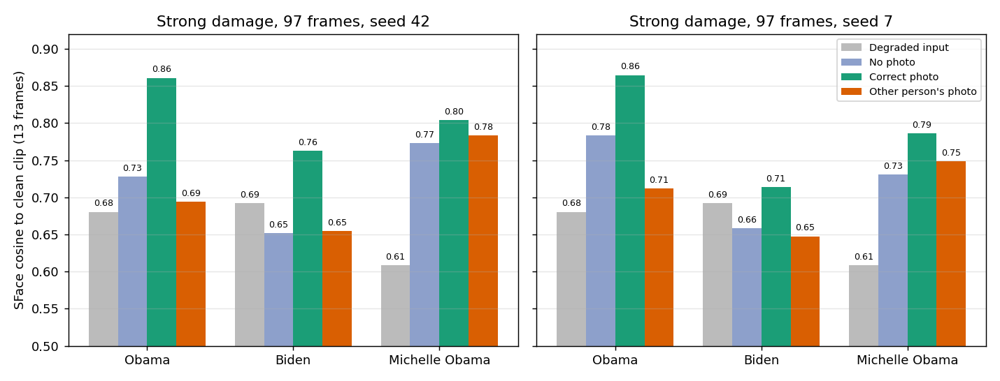
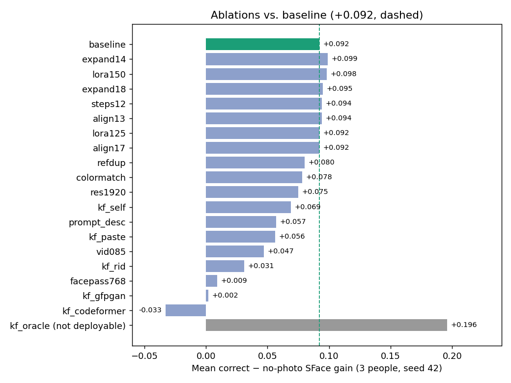

# FaceTrue Restore: technical report

Reference-photo-guided face restoration for old video, built on LTX-2.5 and the Restore IC-LoRA. Open weights only.

Every number in this report comes from a run log or score file produced on the project's RTX 5090. The raw files are local evaluation records, kept out of git because they contain video. The [source list](#appendix-where-each-number-comes-from) at the end names the file behind each table.

## 1. Abstract

FaceTrue Restore restores a damaged video with LTX-2.5 22B and the Restore IC-LoRA. It can also take one separate photo of the person. The photo is placed on a gray, output-sized canvas at the face's position and given to the model as an extra guide. The app renders the clip with and without the photo, using the same seed, and shows the two results side by side.

We measured the photo's effect on three public-domain U.S. government clips (Barack Obama, Joe Biden, Michelle Obama). Each clip got heavy synthetic damage. We then compared three runs per clip: no photo, the correct person's photo, and a different person's photo (the control). The score is SFace cosine similarity to the clean original on 13 sampled frames.

- **Seed 42:** the correct photo raised the mean score from 0.717 (no photo) to 0.809 (+0.092). The other person's photo gave 0.711. The correct photo beat no photo in 38 of 39 frames.
- **Seed 7:** the gain was +0.064, again 38 of 39 frames.
- **Mild damage:** the effect was close to zero.

Five rounds of tuning (about 40 configurations, including an attention mask, photo-only guidance and a Qwen-Image-Edit keyframe) found nothing reliably better than the baseline. The one "oracle" run, which is not deployable, shows a ceiling of +0.196. That run used the clean ground-truth first frame as a keyframe.

## 2. Method

### 2.1 Model and settings

| Item | Value |
|---|---|
| Video model | LTX-2.5 22B distilled transformer, ConvRot INT8 (`ltx-2.5-22b-distilled-transformer-comfy-int8-convrot.safetensors`) |
| Restoration adapter | LTX-2.5 Restore IC-LoRA 1.0, strength 1.0 |
| Text encoder | Gemma 4 12B with LTX projections, ConvRot INT8 (Lightricks package) |
| VAE | LTX-2.5 Conv video VAE, bf16 |
| Sampling | 8 distilled steps, fixed sigma schedule, CFG 1 (negative prompt therefore inactive) |
| Output canvas | 1280×736 at 24 fps (padded, aspect preserved); 960×544 spatial tiles |
| Runtime | ComfyUI on one RTX 5090 (32,607 MiB), started with `--lowvram` |

The graph is Lightricks' Restore workflow, adapted as described in [workflows/PROVENANCE.md](../workflows/PROVENANCE.md). It uses no partner or API nodes.

### 2.2 Reference canvas

The user clicks the person's face on the normalized first frame (a bounding box in output pixels). They then supply a separate photo and confirm the face crop in it. `app/reference.py` builds an output-sized canvas filled with gray (128,128,128) and pastes the photo's face crop into the selected box. The canvas is fed through `LTXAddVideoICLoRAGuide` at `frame_idx=-1` and strength 1.0 as an extra guide image. The photo is therefore a placed hint, not a frame of the video. The no-photo arm runs the same graph with the photo guide node removed. The separate `LTXVAddGuide` node supplies the preceding window's restored frames during chaining.

### 2.3 Windows and chaining

LTX renders at most 97 frames per call (8n+1 frames). `app/chunking.py` splits longer clips into 97-frame windows with a 17-frame overlap (stride 80). For each window after the first, the last 17 restored frames of that arm's previous window are fed back as a guide at frame 0. Each arm (no photo, with photo) carries its own history, so the two never mix. Padding on the final window is removed, and the output frame count is checked against the input. All scored runs in this report are 97 frames, which is a single window. The 240-frame runs used three windows per arm.

## 3. Evaluation setup

### 3.1 Data

All clips and photos are works of the U.S. federal government (the White House or the State Department), downloaded from Wikimedia Commons. Each clip was trimmed to 11 s and normalized to 1280×736 at 24 fps. The first 97 frames were scored.

| Person | Clip | Correct photo | Control photo (other person) |
|---|---|---|---|
| Barack Obama | [2013-09-28 Weekly Address](https://commons.wikimedia.org/wiki/File:2013-09-28_President_Obama%27s_Weekly_Address_HD.webm), from 295.5 s | [Official portrait, Pete Souza, 2012](https://commons.wikimedia.org/wiki/File:President_Barack_Obama.jpg) | [Mike Pence official portrait](https://commons.wikimedia.org/wiki/File:Mike_Pence_official_Vice_Presidential_portrait.jpg) |
| Joe Biden | [2016-07-09 VPOTUS Weekly Address](https://commons.wikimedia.org/wiki/File:20160709_VPOTUS_Weekly_Address_HD.webm), from 105.5 s | [Official portrait 2013, David Lienemann](https://commons.wikimedia.org/wiki/File:Joe_Biden_official_portrait_2013.jpg) | [John Kerry official portrait](https://commons.wikimedia.org/wiki/File:John_Kerry_official_Secretary_of_State_portrait.jpg) |
| Michelle Obama | [2014-05-10 Weekly Address](https://commons.wikimedia.org/wiki/File:Weekly_Address-_The_First_Lady_Marks_Mother%27s_Day_and_Speaks_Out_on_the_Tragic_Kidnapping_in_Nigeria.webm), from 277.5 s | [2013 official portrait, Chuck Kennedy](https://commons.wikimedia.org/wiki/File:Michelle_Obama_2013_official_portrait.jpg) | [Kamala Harris VP portrait (cropped)](https://commons.wikimedia.org/wiki/File:Kamala_Harris_Vice_Presidential_Portrait_(cropped).jpg) |

The reference photos are separate portraits taken on different dates from the clips. No video frame is used as a reference. These people are public figures, shown only to measure restoration. Nothing here suggests that they endorse the project.

### 3.2 Damage

The damage is synthetic. The clean, normalized clip is degraded with FFmpeg, then fed to all three arms.

| Level | Recipe |
|---|---|
| **Strong (main results)** | Downscale to 1/5 (256×146, area), Gaussian blur σ=1.0, upscale back (bicubic), saturation 0.25, `eq=contrast=0.8:brightness=0.03:gamma=1.1`, chroma shift (cbh=6, crh=−6), temporal noise 12 (seed 42), H.264 CRF 36 |
| Mild (repo default) | Downscale by 4, Gaussian blur σ=1.2, upscale back, H.264 CRF 32 |

The full strong filter string is:

```
scale=256:146:flags=area,gblur=sigma=1.0,scale=1280:736:flags=bicubic,hue=s=0.25,eq=contrast=0.8:brightness=0.03:gamma=1.1,chromashift=cbh=6:crh=-6,noise=alls=12:allf=t:all_seed=42
```

The noise seed is fixed, so the damaged input is byte-identical across both render seeds (same SHA-256).

### 3.3 Metric and protocol

- **Arms:** no photo, correct photo, other person's photo. All three use the same seed, steps, prompt, input bytes and face box.
- **Frames:** 13 sampled frames per clip (every 8th frame, 0 to 96).
- **Score:** YuNet face detection, then SFace embedding cosine to the same frame of the clean clip. Higher means more similar. A face was found in every sampled frame of every arm, so common coverage was 13/13 everywhere.
- **Reported:** per-clip means, correct − no photo, correct − other photo, and the number of frames where correct beats the other arm.
- **Seeds:** 42 and 7.
- **Why the control matters:** a gain from the correct photo alone could just mean "any sharp face helps". The other-person photo checks that the gain is specific to the right identity.

## 4. Main results (strong damage, 97 frames)



| Person | Seed | Degraded input | No photo | Correct photo | Other photo | Correct − none | Correct − other | Frames correct > none | Frames correct > other |
|---|---|---|---|---|---|---|---|---|---|
| Obama | 42 | 0.680 | 0.728 | **0.861** | 0.694 | **+0.133** | +0.167 | 13/13 | 13/13 |
| Biden | 42 | 0.692 | 0.652 | **0.762** | 0.654 | **+0.111** | +0.108 | 13/13 | 13/13 |
| Michelle Obama | 42 | 0.608 | 0.773 | **0.804** | 0.783 | **+0.031** | +0.020 | 12/13 | 12/13 |
| **Mean** | 42 | 0.660 | 0.717 | **0.809** | 0.711 | **+0.092** | +0.098 | 38/39 | 38/39 |
| Obama | 7 | 0.680 | 0.783 | **0.865** | 0.712 | **+0.082** | +0.153 | 13/13 | 13/13 |
| Biden | 7 | 0.692 | 0.658 | **0.714** | 0.647 | **+0.056** | +0.067 | 13/13 | 13/13 |
| Michelle Obama | 7 | 0.608 | 0.731 | **0.786** | 0.749 | **+0.055** | +0.038 | 12/13 | 12/13 |
| **Mean** | 7 | 0.660 | 0.724 | **0.788** | 0.703 | **+0.064** | +0.086 | 38/39 | 38/39 |

Across both seeds, the correct photo beat no photo in **76 of 78** sampled frames, and it beat the other person's photo in **76 of 78**.

What the table shows:

- **Identity-specific gain:** the other person's photo gives roughly the same score as no photo (mean 0.711 vs 0.717 at seed 42). So the gain comes from the right face, not just from adding any face.
- **Varies by person:** large for Obama and Biden, small for Michelle Obama. At seed 42, her no-photo result was already 0.773.
- **Seed noise is large:** Obama's gain is +0.133 at seed 42 and +0.082 at seed 7. With three people and two seeds, this is a pilot, not a benchmark.
- **Biden without a photo:** the restoration scored 0.652, below the damaged input (0.692). Restoration alone can drift away from the person, and the photo pulls it back (0.762).

### 4.1 Mild damage (repo default, seed 42)

With mild damage the input is already close to the original (0.873 to 0.888), and the photo adds little:

| Person | Degraded input | 97 frames: correct − none | 97 frames: correct − other | 240 frames: correct − none | 240 frames: correct − other |
|---|---|---|---|---|---|
| Obama | 0.888 | +0.018 | +0.027 | +0.014 | +0.031 |
| Biden | 0.884 | −0.007 | +0.005 | +0.005 | +0.004 |
| Michelle Obama | 0.873 | −0.004 | +0.001 | −0.003 | +0.002 |

The 240-frame runs sample 31 frames per clip and use three chained windows per arm.

## 5. Runtime and memory

All measurements come from one RTX 5090 (32,607 MiB) with ComfyUI `--lowvram`, 8 steps, at 1280×736. The Mac sends requests through the local proxy.

| Job | Frames | What is timed | Wall time |
|---|---|---|---|
| Small preflight | 49 | Both arms + comparison export (`scripts/restore.py`) | 110.4 s |
| Window preflight | 97 | Both arms + comparison export | 177.9 s |
| Full short clip | 240 (3 windows per arm) | Both arms + comparison export | 482.4 s |
| Strong-damage pilot | 9 renders × 97 | Three arms × three clips + scoring | 662.2 s |
| Mild pilot, 97 | 9 renders × 97 | Three arms × three clips + scoring | 661.5 s |
| Mild pilot, 240 | 9 renders × 240 | Three arms × three clips + scoring | 2,086.6 s |

- **Per window:** at 1280×736 and 8 steps, one 97-frame render took 70.6 to 81.7 s across the tuning runs (70.7 s for each clip of the seed-7 baseline). Over the whole strong pilot, including scoring, it works out to about 74 s per render (662.2 s / 9).
- **Higher resolution:** rendering at 1920×1088 took about 151 to 156 s per render.
- **GPU memory:** the sampled whole-device peak was 31,927 to 32,087 MiB across the three pilot runs (`nvidia-smi`, every 200 ms). This is device usage, not an exact model allocation.
- **Stability:** no out-of-memory errors in the recorded runs. One early 49-frame attempt failed after 4.6 s with a ComfyUI job failure, before the recorded runs.
- **Not measured:** GPU-PC system RAM, and the split between model loading, sampling and decoding.

## 6. Ablations and negative results

All ablations use the strong-damage set, seed 42, and the same metric. The baseline is **correct − none = +0.092** with 38/39 frames. "c−n" is correct − no photo, and "c−w" is correct − other photo, both as means over the three people.



The chart covers rounds 1–3. Rounds 4 and 5 are in the tables below.

### 6.1 Round 1: guidance strength, canvas, and sampling (11 configurations)

| Config | Change | c−n | c−w | Frames c > n | Verdict |
|---|---|---|---|---|---|
| baseline | — | +0.092 | +0.098 | 38/39 | — |
| lora125 | Restore LoRA strength 1.25 | +0.092 | +0.090 | 38/39 | No gain |
| lora150 | Restore LoRA strength 1.5 | +0.098 | +0.088 | 37/39 | Within noise; c−w lower |
| expand14 | Face box on the canvas grown 1.4× (includes hair, jaw, ears) | +0.099 | +0.098 | 38/39 | Best, but within seed noise |
| expand18 | Face box grown 1.8× | +0.095 | +0.092 | 38/39 | Same as expand14 |
| colormatch | Photo colors matched to the clip | +0.078 | +0.102 | 37/39 | Worse |
| refdup | Photo guided at two frame positions | +0.080 | +0.082 | 32/39 | Hurt Michelle (−0.001) |
| facepass768 | Extra high-resolution pass on a face crop | +0.009 | +0.063 | 17/39 | Much worse |
| vid085 | Video guide strength 0.85 | +0.047 | +0.129 | 29/39 | Worse |
| steps12 | 12 steps instead of 8 | +0.094 | +0.090 | 38/39 | No gain, about 40% slower |
| expand14 + lora125 | Both | +0.097 | +0.090 | 37/39 | Michelle correct < other (−0.005). Rejected |
| expand14, seed 7 | Seed check | +0.074 (baseline +0.064) | +0.081 | 39/39 | Same small edge |

Why no change was adopted:

- **expand14 is the best, but the edge is tiny.** It gains about +0.01. Seed noise is about 0.05: Obama alone moves from +0.133 to +0.082 between seeds.
- **One visible artifact:** in one Biden seed-7 render, expand14 shows a faint rectangular edge around the head.
- **Decision:** it stays on a side branch, `tune/reference-strength`, and is not merged.

The reference guide strength was already 1.0, the maximum, so it was not raised.

### 6.2 Round 2: prompt, resolution, alignment, and the first frame as a keyframe

| Config | Change | c−n | c−w | Frames c > n | Verdict |
|---|---|---|---|---|---|
| prompt_desc | Detailed per-clip text prompt | +0.057 | +0.066 | 36/39 | Worse; raises the no-photo score (0.744) instead |
| res1920 | Render at 1920×1088, then downscale | +0.075 | +0.114 | 34/39 | Worse and twice as slow |
| align13 / align17 | Canvas alignment box 1.3× / 1.7× | +0.094 / +0.092 | +0.088 / +0.087 | 38/39 / 39/39 | No gain |
| kf_paste | Photo face blended onto frame 0, used as a keyframe | +0.056 | +0.143 | 31/39 | Visible pop: frame 0 smiles like the photo, then snaps back by frame 8 |
| kf_self | Frame 0 of the photo arm fed back as a keyframe | +0.069 | +0.084 | 33/39 | Worse |
| kf_rid | Frame 0 restored by RestorerID (photo-guided face restorer), as a keyframe | +0.031 | +0.082 | 26/39 | Worse; Michelle −0.046 |
| **kf_oracle** | **Clean ground-truth frame 0 as the keyframe (not deployable)** | **+0.196** | −0.011 | 39/39 | **Ceiling only** |

**The oracle result is the key finding of round 2.**

- **Frame 0 sets identity for the whole clip.** When frame 0 is perfect, the mean jumps to 0.913. The photo then stops mattering: c−w is about 0.
- **A real keyframe isn't good enough yet.** The RestorerID keyframe scored 0.730 against the ground-truth frame 0. LTX's own photo-guided frame 0 already scored 0.764, so the "better" keyframe was actually worse.
- **Caveat on kf_rid:** its settings were picked by looking at ground-truth scores, which is a mild selection bias.

### 6.3 Round 3: photo-free face restorers as keyframe generators

GFPGAN v1.4 and CodeFormer restore frame 0, which is then used as the keyframe. Neither takes a reference photo, so the correct and other-photo arms get the same keyframe.

| Config | c−n seed 42 | c−w seed 42 | c−n seed 7 | c−w seed 7 |
|---|---|---|---|---|
| baseline (no keyframe) | +0.092 | +0.098 | +0.064 | +0.086 |
| kf_rid (round 2) | +0.031 | +0.082 | — | — |
| GFPGAN v1.4 | +0.002 | +0.015 | −0.008 | +0.016 |
| GFPGAN v1.4, color-matched | −0.008 | +0.008 | −0.025 | +0.005 |
| CodeFormer w=0.5 | −0.033 | −0.000 | −0.031 | +0.006 |

Before any render, each restored keyframe was scored against the ground-truth frame 0 (mean over 3 people × 2 seeds):

| Keyframe | LTX's own frame 0 | GFPGAN | CodeFormer w=0.5 |
|---|---|---|---|
| SFace to ground-truth frame 0 | 0.726 | 0.721 | 0.677 |

Why it failed:

- **Not more faithful:** none of the restorers produced a frame 0 closer to the real face than LTX's own.
- **The photo gets overridden:** because the keyframe fixes identity for the whole clip, c−w falls to about 0.
- **Decision:** the code is kept on the side branch `tune/keyframe-restorer` and is not merged. These restorers are not part of the shipped pipeline.

### 6.4 Round 4: more photo guides, a second photo, and identity-conditioned keyframes

Seed 42 only, because nothing beat the baseline at seed 42. The no-photo arm is reused from the baseline run.

| Config | Change | c−n | c−w | Verdict |
|---|---|---|---|---|
| baseline | — | +0.092 | +0.098 | — |
| mp_0_48 | Extra copies of the photo guide at frames 0 and 48 | +0.067 | +0.168 | Worse; Michelle −0.020 |
| mp_48 | Extra copy at frame 48 | +0.084 | +0.126 | Worse |
| mp_24_48_72 | Extra copies at frames 24, 48 and 72 | +0.092 | +0.147 | Ties the baseline (best multi-position) |
| mp_0_48 @0.6 | Extras at frames 0 and 48, strength 0.6 | +0.061 | +0.170 | Worse |
| photo2 @−1 | A second public-domain photo as an extra guide | +0.074 | +0.056 | Worse; wrong ≥ correct for two people |
| photo2 @48 | Second photo at frame 48 | +0.090 | +0.116 | Ties the baseline |
| photo2 @48 + photo1 @24,72 | Combined | +0.094 | +0.163 | +0.002 over baseline, within noise |
| IP-Adapter plus-face keyframe | SDXL img2img frame 0 conditioned on the photo | — | — | Failed the keyframe gate: no better than LTX's own frame 0 |
| InstantID keyframe | InstantID img2img frame 0 as a keyframe | +0.044 | +0.176 | Worse; also needs the non-commercial antelopev2 face model |

The best deployable result was +0.094, against a bar of +0.12. Michelle stayed at +0.02 to +0.035 in every variant. Round 4 code is on the side branch `tune/round4` and is not merged.

### 6.5 Round 5: research-guided experiments

These experiments came from the [research notes](RESEARCH_NOTES.md) and followed the [improvement plan](IMPROVEMENT_PLAN.md). Screening used two people (Obama and Michelle) at seed 42, so the baseline mean c−n here is **+0.082**, not the three-person +0.092. Runs that did not change the no-photo path reused the baseline's no-photo arm. A single number in a person's column is the correct arm. "–" means the value was not computed for that run.

| Run | Obama correct / wrong / none | Michelle correct / wrong / none | Mean c−n | c−w Obama / Michelle | Face LPIPS Obama / Michelle | Flicker Obama / Michelle |
|---|---|---|---|---|---|---|
| baseline | 0.8607 / 0.6937 / 0.7277 | 0.8038 / 0.7834 / 0.7728 | +0.082 | +0.167 / +0.020 | 0.1586 / 0.2267 | 2.069 / 1.210 |
| A1 attention mask (advanced guide) | 0.8629 | 0.8068 | – | – | – | – |
| A2 attention mask (grow 1.5, feather 0.1) | 0.8618 | 0.8105 | – | +0.155 / +0.020 | 0.1604 / 0.2268 | 2.042 / 1.193 |
| C reference-only guidance, α = 0.25 | 0.8609 | 0.7885 | – | +0.195 / +0.045 | 0.1606 / 0.2304 | 2.104 / 1.266 |
| photo-only attention × 1.25 | 0.8525 | 0.8171 | – | +0.159 / +0.050 | 0.1590 / 0.2323 | 2.034 / 1.177 |
| photo-only attention × 1.5 | 0.8486 | 0.8121 | – | – | 0.1586 / 0.2288 | 1.997 / 1.167 |
| B Qwen-Image-Edit keyframe, strength 0.8 | 0.8457 / 0.6772 / 0.8073 | 0.8005 / 0.7747 / 0.7325 | +0.053 | +0.168 / +0.026 | 0.1491 / 0.2290 | 1.762 / 1.012 |
| B Qwen-Image-Edit keyframe, strength 0.6 | 0.8461 / 0.6844 / 0.8208 | 0.8021 / 0.7899 / 0.7705 | +0.028 | +0.162 / +0.012 | 0.1445 / 0.2342 | 1.784 / 1.051 |

Notes:

- **Flicker** is the motion-compensated temporal error on frames 81–96 (lower is steadier). The clean clip scores 1.223 (Obama) and 0.753 (Michelle). **Face LPIPS** is measured against the clean clip.
- **A (attention mask):** the mask was confirmed to take effect, but the correct arm rose only +0.001 to +0.007.
- **C and attention scaling:** C lowered Michelle's correct arm. Attention × 1.25 moved the two-person mean by about +0.0025 and × 1.5 by about −0.002: Michelle went up and Obama went down.
- **B (Qwen-Image-Edit-2511 keyframe, Apache-2.0):** at strength 0.8 the clip pops at frame 0 (Obama correct 0.69 at frame 0 vs. 0.82 for the baseline) and recovers by frame 8. At 0.6 the pop is gone, but the correct arm is still slightly below the baseline. The Qwen keyframes match the clean frame 0 only weakly: Obama 0.741 for both the correct and no-photo keyframes, Michelle 0.580 correct vs. 0.633 no-photo. Qwen also lifts the no-photo arm (Obama none +0.08 to +0.09), which shrinks the gain from the photo. B improved flicker and LPIPS, but not identity.
- **Michelle diagnosis (no GPU):** her reference photo matches the clean clip at SFace 0.622 (range 0.583–0.655), against 0.794 for Obama and 0.673 for Biden. Her pose range is narrow, and her gain does not correlate with yaw (−0.03), photo-to-frame similarity (0.02) or brightness (−0.28). It is not a pose or lighting issue. The photo is simply a weak identity match, while the no-photo result is already 0.773, so the photo has little to add.
- **Verdict: no deployable gain.** Nothing passed the acceptance bar at seed 42, so nothing was expanded to seed 7. The baseline is kept. Round 5 code is on the side branch `tune/round5` and is not merged.

### 6.6 Summary

| Round | Configs | Best deployable c−n | Adopted |
|---|---|---|---|
| 1 | 11 | +0.099 (expand14) | No; within seed noise |
| 2 | 8 (incl. oracle) | +0.094 (align13) | No |
| 3 | 6 runs (3 configs × 2 seeds) | +0.002 (GFPGAN, seed 42) | No |
| 4 | 9 | +0.094 (photo2 @48 + photo1 @24,72) | No; within noise |
| 5 | 7 (two people, seed 42) | +0.0025 over its +0.082 baseline (attention × 1.25) | No |
| Oracle ceiling | 1 | +0.196 (not deployable) | — |

The shipped configuration is the baseline. The gap to the oracle suggests that a more faithful first frame is the main remaining lever.

For an external literature review of what could close this gap, see the [research notes](RESEARCH_NOTES.md). The follow-up experiments and their stop rules are in the [improvement plan](IMPROVEMENT_PLAN.md).

## 7. Limitations

- **Three people, two seeds.** This is a pilot. Seed-to-seed variation (about 0.05 for one person) is as large as most differences between configurations. Frames within a clip are not independent, so we report no significance test.
- **Small effect on mild damage.** When the input is already close to the original, the gain is near zero and can be slightly negative (−0.007 for Biden at 97 frames).
- **Synthetic damage only.** The FFmpeg recipe imitates old tape, but it is not real VHS or film. No real archival footage with a known true face was scored.
- **Side effects outside the face.** The photo arm can change the background: the flag emblem in the Biden clip, wall and suit textures. It can also over-sharpen. These changes are visible in the side-by-side videos.
- **SFace is only a proxy.** A higher score means the embedding is closer to the clean frame. It does not prove that details are historically correct. Part of the gain may come from the result looking more like the reference photo. That is why we also report the other-person control.
- **Fixed placement.** The photo sits at one fixed box for the whole window. The MVP has no face tracking and supports one person per clip, and it was tested on clips of up to 10 s.
- **Generative output.** The model can change expression, age, color or small objects. Seams between chained windows still need checking by eye.
- **Prior work exists.** Reference-guided face video restoration is not new. Examples include IP-FVR, RG-FVR, Topaz's commercial tools, and community LTX Restore front-ends on Hugging Face Spaces ([winterwarrior/ltx-restore-demo](https://huggingface.co/spaces/winterwarrior/ltx-restore-demo), [breslavsky/ltx-restore-studio](https://huggingface.co/spaces/breslavsky/ltx-restore-studio)). This project's contribution is the local, open-weights LTX pipeline with a photo canvas, the synchronized no-photo / with-photo comparison, and the controlled measurement above.

## 8. Reproduction

Mac app, mock mode (no GPU):

```bash
git clone https://github.com/junjunjunbong/facetrue-restore.git
cd facetrue-restore
bash scripts/setup.sh
.venv/bin/python -m pytest -q
bash scripts/run.sh            # http://127.0.0.1:8000
```

GPU setup: install ComfyUI and ComfyUI-LTXVideo at the pinned revisions, plus the four model files, by following [MODELS.md](MODELS.md). Then:

```bash
# on the GPU PC
python main.py --listen 0.0.0.0 --port 8188 --lowvram

# on the Mac
bash scripts/setup.sh --comfy
# .env: FACETRUE_MODE=comfy, COMFYUI_URL=http://<gpu-pc>:8188, COMFY_PROXY_URL=http://127.0.0.1:8189
bash scripts/run_proxy.sh
.venv/bin/python scripts/doctor.py --require-gpu
```

Hardware preflight (section 5):

```bash
FACETRUE_MODE=comfy .venv/bin/python scripts/restore.py data/preflight-97.mp4 \
  --photo data/separate-photo.jpg --bbox 500,150,220,260 \
  --output data/preflight/run-97 --seed 42
```

Three-arm evaluation:

```bash
.venv/bin/python scripts/download_eval_models.py          # YuNet + SFace, hash-checked
FACETRUE_MODE=comfy .venv/bin/python scripts/evaluate.py data/evaluation/pilot.json \
  --output data/evaluation/run-001 --direct
```

- **Manifest:** the format is in [EVALUATION.md](EVALUATION.md). Fill it with the Commons files from section 3.1, and set `seed` to 42 or 7.
- **Default damage:** `scripts/evaluate.py` applies the mild recipe.
- **Strong damage:** for the main table, we ran the same script through a local wrapper. The wrapper changes only `app.evaluation.prepare_degraded_clip`, so the clean clip is degraded with the strong filter in section 3.2 at H.264 CRF 36. Everything else, including rendering, sampling and scoring, is the repository's code.

## 9. Models and licenses

The shipped pipeline uses open weights only. It makes no hosted or partner API calls, and every model runs locally in ComfyUI.

| Component | Role | License |
|---|---|---|
| LTX-2.5 22B distilled (INT8 ConvRot) | Core video model | [LTX-2.x Community License](https://github.com/Lightricks/LTX-2/blob/main/LICENSE-2_x) |
| LTX-2.5 Restore IC-LoRA 1.0 | Restoration adapter | LTX-2.x Community License |
| LTX-2.5 Conv video VAE | Encode/decode | LTX-2.x Community License |
| Gemma 4 12B with LTX projections (INT8, Lightricks package) | Text conditioning | LTX-2.x Community License; Google's Gemma 4 12B base is Apache-2.0 |
| OpenCV Haar cascade | Face proposals in the UI | Intel Open Source Computer Vision Library license |
| YuNet 2023mar | Face detection (evaluation only) | MIT |
| SFace 2021dec | Face embedding (evaluation only) | Apache-2.0; training-data provenance unverified |

GFPGAN, CodeFormer, RestorerID, IP-Adapter, InstantID and Qwen-Image-Edit were used only in the negative experiments in section 6. They are not part of the shipped app. CodeFormer's license is non-commercial. App code is MIT. Full terms, file names and hashes are in [MODELS.md](MODELS.md) and [EVALUATION.md](EVALUATION.md).

## Appendix: where each number comes from

The `data/` paths are local evaluation records, gitignored because they contain video.

| Section | Source |
|---|---|
| 4, seed 42 | `data/eval-pd/run-97-strong/summary.csv`, `frames.csv`, `run.json` (degradation recipe) |
| 4, seed 7 | `data/eval-pd/tune/runs/base_s7/summary.csv`; frame counts in `data/eval-pd/tune/PROGRESS.md` |
| 4, degraded input | `data/eval-pd/report/degraded_scores.json`, recomputed with the evaluation's SFace engine on the same 13 frames (also listed in README) |
| 4.1 | `data/eval-pd/run-97/summary.csv`, `data/eval-pd/run-240/summary.csv`, `data/eval-pd/report/degraded_scores_mild97.json` |
| 5 | [GPU_PREFLIGHT.md](GPU_PREFLIGHT.md); per-render times in `data/eval-pd/tune/PROGRESS.md` and `data/eval-pd/tune2/PROGRESS.md` |
| 6.1 | `data/eval-pd/tune/PROGRESS.md`, `NOTES.md` |
| 6.2 | `data/eval-pd/tune2/PROGRESS.md` |
| 6.3 | `data/eval-pd/tune3/summary.md`, `PROGRESS.md` |
| 6.4 | `data/eval-pd/tune4/PROGRESS.md`, `kfscores4.json` |
| 6.5 | `data/eval-pd/tune5/PROGRESS.md`, `diag/michelle_diag.json`; summary in `experiments/tune5_round5/README.md` on branch `tune/round5` (commit 97852d9) |
| 9 | [MODELS.md](MODELS.md), [EVALUATION.md](EVALUATION.md) |
